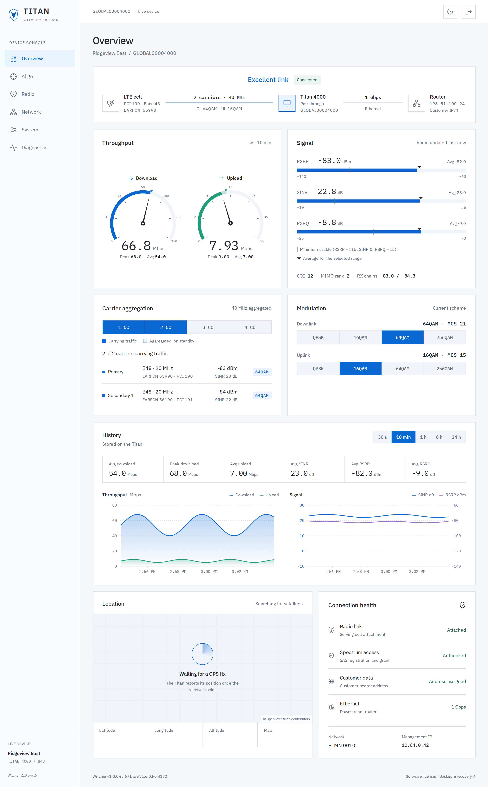
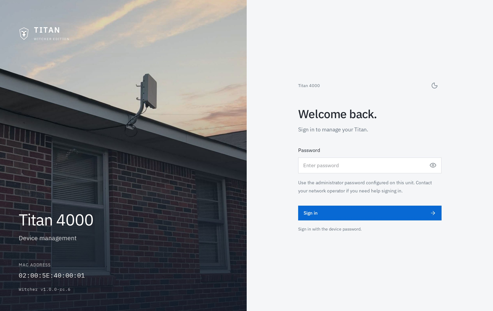
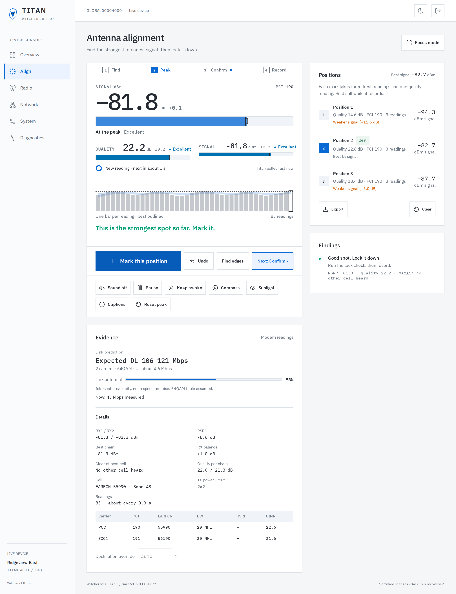
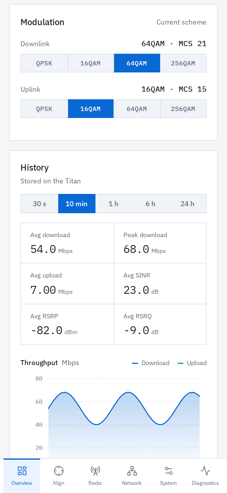
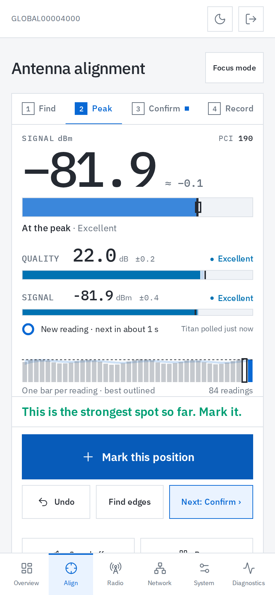
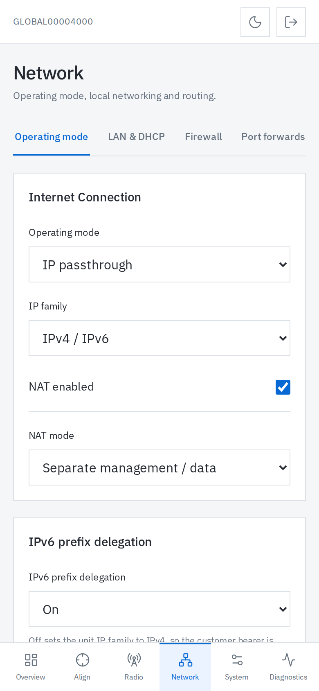

# Titan 4000 Witcher Edition

**WISPs should own their stack.** You ought to be able to fix the equipment you
paid for and decide how your network runs. That's right to repair, and Witcher
is our first step toward it, starting with the Global Telecom Titan 4000 LTE CPE.

Witcher gives the Titan a fast management interface, useful diagnostics, and
repairs for the networking problems operators deal with in the field. It runs
on the unit without a cloud account or controller.

We've learned a lot about making applications run fast since this hardware
was built. It deserved more love, so Witcher is our love letter to it: modern
software fitting of the hardware. Finding a problem, fixing it, and sharing
what worked is the WISP way. Bring your bench unit and your ideas.

**[Download Witcher firmware](https://github.com/centrevilletech/titan-4000-witcher-edition-fw/releases)**
· [Build it yourself](docs/building.md)
· [Learn LTE at TheEdgeMile.com](https://theedgemile.com/)

## Install it from your browser

Witcher has been tested on multiple **Titan 4000 Band 48 (CBRS) units**.
Other models and band variants have not been tested. Installation uses the
firmware upload page already on your device.

1. Download the `.prg` from [GitHub Releases](https://github.com/centrevilletech/titan-4000-witcher-edition-fw/releases)
   and verify it against the included `SHA256SUMS`.
2. Upload it through the Titan's **desktop firmware upgrade page**, or
   **System → Firmware** if it already runs Witcher. Keep power connected.
3. Open `https://DEVICE_IP/`, accept the unit's self-signed certificate, and
   sign in with the administrator password you used before upgrading.

Witcher prepares persistent storage and a unique TLS identity automatically.
Ethernet setup works without internet access, terminal commands, or
preinstalled SSH keys. The login page shows the unit MAC and firmware version.

Management is enabled on every assigned IPv4 address by default, including
customer/public APNs, in NAT and passthrough modes. Set a unique administrator
password before exposing the unit.

## Tools for the tower and the bench

- Download/upload speedometers, traffic history, signal readings, carrier
  aggregation and modulation details, plus GPS location when a fix is available.
- An alignment workflow with Find, Peak, Confirm and Record, position marks
  based on fresh readings, audio feedback, and CSV export.
- NAT and passthrough settings, APNs, band/PCI selection, IPv6 prefix delegation,
  and automatic recovery for supported downstream-router failures.
- HTTPS, operator-enrolled SSH keys, backups, firmware uploads, and streaming
  ping/traceroute in the browser.

The interface works on desktop and phone screens, with light and dark themes.
Settings writes check their results and reject stale revisions.

Traffic and radio history covers the last 24 hours. Live readings stay in RAM;
compact snapshots use about 170 KB and are saved every 15 minutes, with a final
save on orderly service shutdown. Sudden power loss can lose readings since
the last successful snapshot. Saves pause if storage is nearly full, preserving
the previous snapshot and leaving room for device settings. Saved readings survive a
startup clock correction; gaps represent missing samples, not zero traffic.

  
  
  

Screenshots use the current device UI with synthetic data. More views and the
capture instructions are in the [screenshot gallery](docs/screenshots/README.md).

## A compatible core: Rapid5GS

Witcher works with [Rapid5GS](https://rapid5gs.com/), the Open5GS-based LTE/5G
packet core built for WISPs and private networks. Rapid5GS gets the core
running on your own hardware; Witcher brings the same operator control to
the customer end of the link.

For IPv6 prefix delegation, provision a fixed `/56` for the SIM in the core
and use a dual-stack customer APN. Enable delegation in Witcher's Network
settings. The keeper maintains that prefix across reconnects. Changing the
Network IP-family setting alone does not change an APN's IP type.

For IPv4 passthrough, the keeper repairs customer DHCP offers and missing DHCP
service. It learns a working ARP response from the downstream router, then
uses repeated missed replies to trigger DHCP repair and, if needed, one
Ethernet renegotiation. Recovery is bounded and does not reboot the Titan or
reset LTE. A router that still answers ARP while its internet forwarding is
broken needs a different diagnostic.

See [IPv4 recovery](docs/ipv4-recovery.md) and the
[IPv6 implementation notes](docs/modem-ipv6-pd-patch.md) for the details.

## Access and recovery

Add your public key under **System → Access → SSH keys** for shell access,
then connect with `ssh -p 2222 root@DEVICE_IP`. Root password login is locked.
Keys and each unit's host/TLS identities persist outside the firmware banks.
The native SSH service rejects connections arriving over the customer LTE bearer.

Browser recovery is at `http://DEVICE_IP:8081/`, using the administrator
password. It can open the factory desktop UI or retry Witcher while Linux
and networking are working. If HTTPS initialization fails, HTTP setup remains
available. See [first-boot HTTPS](docs/first-boot-https.md).

To return to stock, upload a compatible vendor `.prg` through
**System → Firmware**. Select the older-image option for an intended downgrade.
The updater checks NAND readback and bank selection before restarting.

## Build with us

Bring a reproducible bug, a router that behaves differently, or a fix someone
else can use. Include the firmware version, operating mode, router model,
steps, and observed result in reports. Keep credentials and customer data out
of shared logs.

The image keeps the factory kernel and modem payload and rebuilds the root
filesystem. CI checks permissions and device nodes, first boot, network
protocols, browser behavior, and credentials in the image and source history.

The API, device-helper and SSH services currently ship as pinned binaries;
their source is maintained separately. Build instructions explain which
components this repository builds from source.

- [Build instructions and repository layout](docs/building.md)
- [Credential handling](SECURITY.md)
- [Component provenance and third-party licenses](THIRD_PARTY.md)
- [Image format and flashing](docs/image-format.md)
- [Spectrum enforcement changes](docs/cbrs-sas-enforcement.md)

## Learn LTE and build something

[TheEdgeMile.com](https://theedgemile.com/) is where we share practical LTE
and private-network guides, field lessons, and hardware to build with. Learn
how the core, radios, SIMs and customer equipment fit together, then put a
network on the bench and try it.

[Rapid5GS.com](https://rapid5gs.com/) has the core software and setup guidance
for the next part of that build.

## About the author

Witcher is built by [Josh Lambert](https://joshlambert.xyz/), a WISP operator
and builder in Centreville, Alabama, and the creator of Rapid5GS. The work
comes from running networks and wanting better tools for the people keeping
them online.

Visit [JoshLambert.xyz](https://joshlambert.xyz/) for writing about wireless
networks and independent building, or [TheEdgeMile.com](https://theedgemile.com/)
for LTE projects, hardware and deployment help.

## License and responsible use

Copyright 2026 Centreville Tech, LLC.

Our original contributions are open source under the
[GNU General Public License, version 3](LICENSE). Vendor firmware and
third-party components retain their own copyright and license terms; see
[NOTICE](NOTICE).

Witcher is an independent community firmware mod developed for education,
experimentation, and a better understanding of the equipment we operate.
It is **not affiliated with, endorsed, authorized, or sanctioned by Global
Telecom**. Product names and trademarks belong to their respective owners.

Installing modified firmware may void your manufacturer's warranty and can
render a device unusable. Use it at your own risk. The software is provided
**as is, without warranty of any kind**, to the extent permitted by law.
To that same extent, Centreville Tech, LLC and the contributors disclaim
liability for damages, service outages, data loss, fines, or penalties arising
from use or misuse of this software. See GPLv3 sections 15 and 16 for the
full warranty disclaimer and limitation of liability.

You are responsible for lawful operation of your equipment, including
applicable spectrum authorizations, equipment requirements, transmit limits,
and CBRS/SAS obligations. Witcher changes local spectrum-enforcement behavior;
read the [implementation notes](docs/cbrs-sas-enforcement.md) before transmitting.
An educational purpose or software license does not authorize radio operation
or establish regulatory compliance. For U.S. CBRS operation, consult
[47 CFR Part 96](https://www.ecfr.gov/current/title-47/chapter-I/subchapter-D/part-96).
